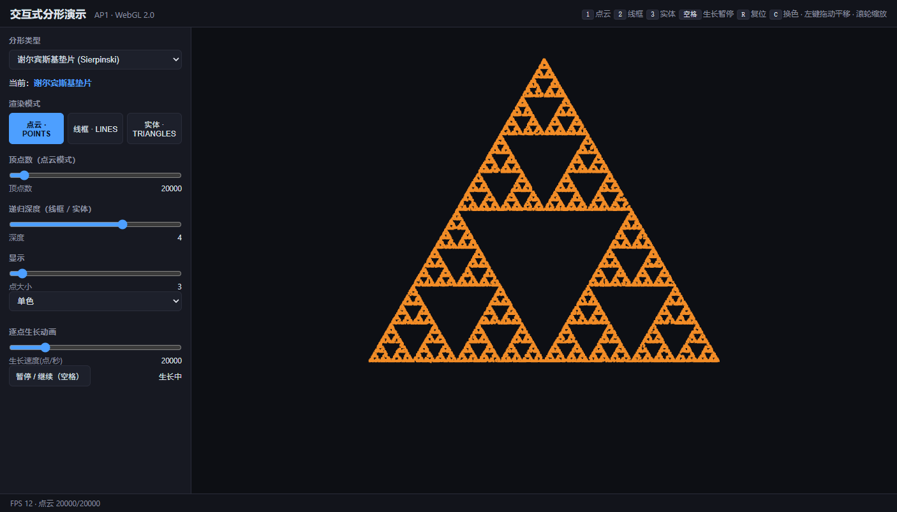
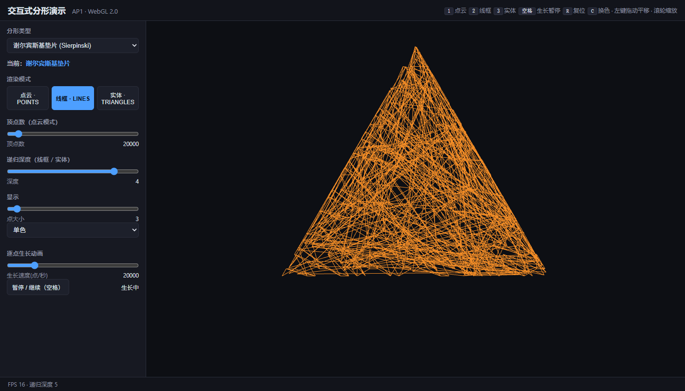
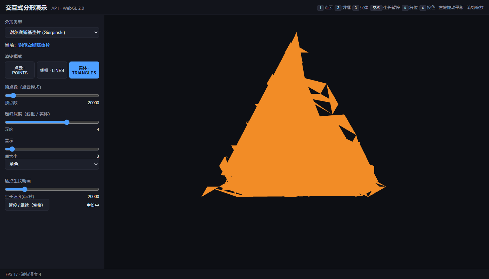
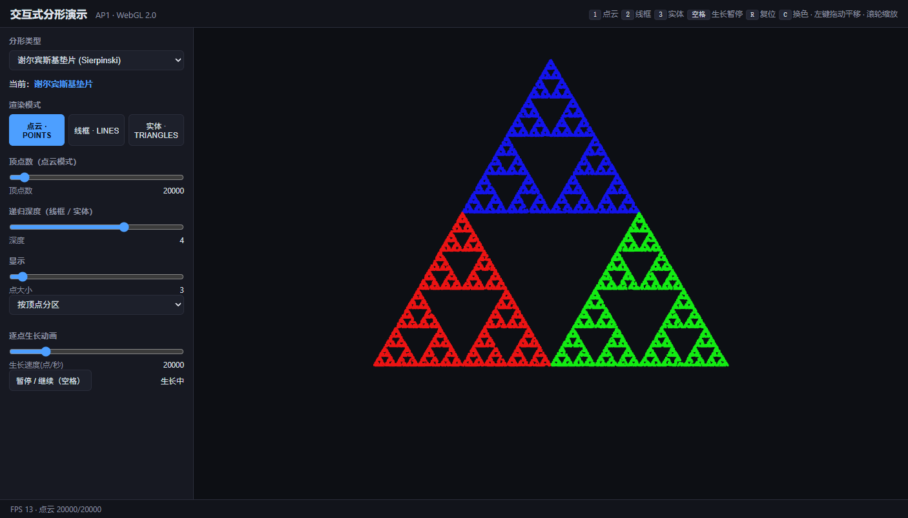
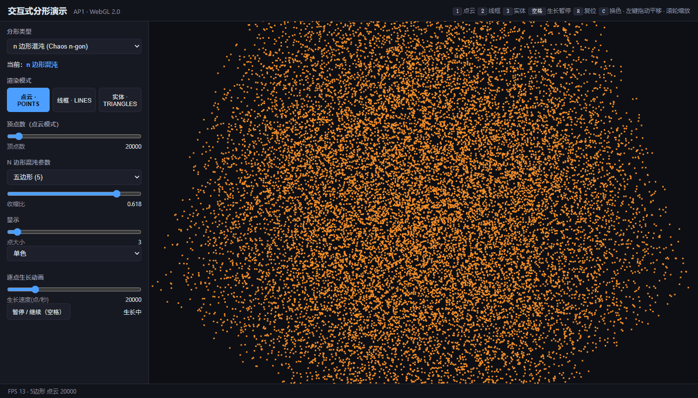
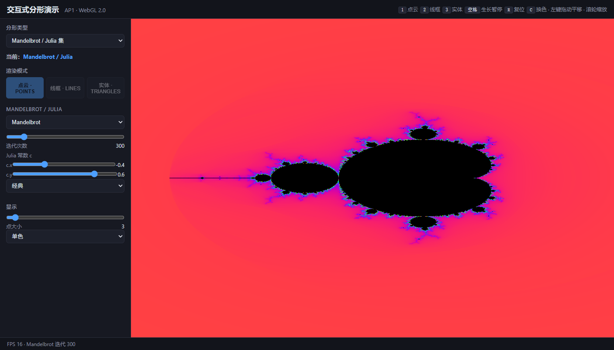
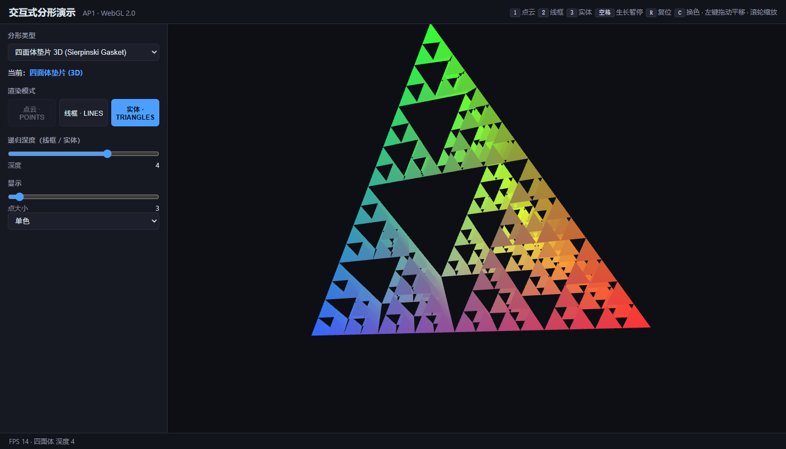

# 交互式 2D 分形（AP1）· WebGL 2.0

计算机图形学课程作业 AP1：用原生 **WebGL 2.0 + JavaScript** 实现的交互式分形演示程序。
两种算法生成**谢尔宾斯基垫片**（混沌游戏 / 递归细分），支持点云、线框、实体三种渲染模式切换，
以及**鼠标平移缩放、键盘模式切换、逐点生长动画**等完整交互。另附三项扩展：
任意 n 边形混沌、Mandelbrot/Julia 集探索器、3D 四面体垫片。

> **在线运行地址：** https://auroral9.github.io/ap1-interactive-fractal/

---

## 1. 运行方式

### 在线运行
项目为纯静态页面，**无需构建、无需安装依赖**，教师/同学点击链接即可运行（推荐在
Chrome / Edge / Firefox 新版浏览器中打开，需要支持 WebGL2）。

### 本地运行
把整个 `ap1-fractal/` 目录放到任意静态服务器即可：

```bash
# 方式一：Python
cd ap1-fractal
python -m http.server 8000
# 浏览器打开 http://localhost:8000

# 方式二：Node
cd ap1-fractal
npx serve .     # 或 npx http-server .
```

> 提示：直接双击 `index.html` 也能运行（本工程不使用任何需要服务器的模块加载器，
> 全部为普通 `<script>` 标签）。

---

## 2. 两种生成算法原理

### 2.1 混沌游戏（Chaos Game）→ 点云模式
给定三角形的三个顶点 `A、B、C`，随机取一个初始点 `p₀`，然后反复执行：

```
pᵢ₊₁ = (pᵢ + 随机一个顶点) / 2
```

即每次把当前点与随机选中的顶点**取中点**。重复足够多次后，点列会以极高的概率落在
谢尔宾斯基垫片上，且不依赖初始点的选择（这就是著名的“混沌游戏”）。本程序默认生成
**20000 个点**（可调，≥ 5000），以 `gl.POINTS` 图元渲染，并支持“逐点生长”动画，
点数从 0 随时间增长到设定值。

实现：`js/geometry/fractals.js` 的 `chaosGame()`。

### 2.2 递归细分（subdivide）→ 线框 / 实体模式
从初始大三角形开始，每层细分把每个三角形**三边取中点，挖去中心的小三角形**，只保留
**3 个角上的三角形**：

```
subdivide(triangle):
    取三边中点 ab、bc、ca
    生成 [A,ab,ca]、[ab,B,bc]、[ca,bc,C] 三个子三角形
```

深度为 d 时得到 `4^d` 个三角形（深度 4 → 256 个，深度 6 → 4096 个）。这同一组三角形
支持三种渲染模式：**点云（gl.POINTS）**、**线框（gl.LINES，边去重）**、**实体
（gl.TRIANGLES，填充）**。程序采用**迭代**方式实现细分，避免深递归爆栈，深度最大支持 6。

实现：`js/geometry/fractals.js` 的 `subdivideTriangle()`、`gasketIndexed()`。

---

## 3. 交互操作说明

| 操作 | 说明 |
| --- | --- |
| **鼠标左键拖动** | 平移视图（2D 分形）；3D 四面体模式下为旋转 |
| **鼠标滚轮** | 缩放（以光标为中心缩放；3D 模式缩放模型） |
| **数字键 `1`** | 切换到**点云**渲染模式 |
| **数字键 `2`** | 切换到**线框**渲染模式 |
| **数字键 `3`** | 切换到**实体**渲染模式 |
| **空格** | 暂停 / 继续“逐点生长”动画 |
| **`R`** | 复位视图 |
| **`C`** | 循环切换配色方案 |

左侧参数面板：
- **顶点数**（点云模式）：混沌游戏点数（默认 20000，最大 300000）；
- **递归深度**（线框 / 实体模式）：0–6；
- **点大小**：1–40 px；
- **配色方案**：单色 / 按顶点分区 / 位置渐变 / 热力图 / 霓虹（≥3 套）；
- **逐点生长速度**：点/秒（默认 20000）；
- **暂停/继续** 按钮（等价于空格）。

---

## 4. 三种渲染模式（截图）

> 以下截图由程序在浏览器中实际渲染获得。

**① 点云模式（混沌游戏，20000 点）**



**② 线框模式（递归细分，深度 5）**



**③ 实体模式（递归细分，深度 4）**



**配色方案示例（“按顶点分区”）**



---

## 5. 扩展功能（+2 分）

### E1 · 任意 n 边形混沌游戏
把混沌游戏推广到正 n 边形（n=3…8），通过**收缩比**滑块调节。五边形使用黄金分割比
`1/φ ≈ 0.618` 可得到漂亮的五角垫片，六边形等可用不同比值观察形态差异。



### E2 · Mandelbrot / Julia 集交互探索器
片元着色器逐像素计算逃逸时间，平滑着色；支持**平移缩放**（鼠标）、**迭代次数**、
**Julia 常数 c**、**三套配色**切换。



### E3 · 3D 四面体垫片预览（为 AP2 铺垫）
递归细分正四面体（每层保留 4 个角四面体），顶点颜色随细分中点插值，产生彩虹渐变；
透视投影 + 深度测试，支持自动视角与鼠标拖动旋转、滚轮缩放。



---

## 6. 技术栈与工程结构

- **原生 WebGL 2.0 + JavaScript**，无框架、无构建步骤；
- 使用教材配套工具库的 API：`Common/initShaders.js`（`initShaders`）、
  `Common/MV.js`（`mat4/perspective/lookAt/rotate/translate/scale/flatten`）、
  `Common/webgl-utils.js`（`setupWebGL`）。本仓库在 `js/utils/` 下提供**自包含的同名实现**
  （接口一致、独立撰写，可直接替换为教材原版）。

```
ap1-fractal/
├── index.html                 # 页面 + 参数面板（HTML 控件）
├── css/style.css              # 界面样式
├── js/
│   ├── main.js                # 应用编排：状态、渲染循环、事件分发
│   ├── palettes.js            # 配色方案
│   ├── geometry/fractals.js   # 几何模块：混沌游戏 / 递归细分 / n边形 / 四面体
│   ├── render/                # 渲染模块
│   │   ├── gasket2d.js        #   2D 垫片（点/线/面，视图变换）
│   │   ├── tetra.js           #   3D 四面体
│   │   └── mandelbrot.js      #   Mandelbrot/Julia
│   ├── interaction/input.js   # 交互模块：鼠标 / 键盘
│   └── ui/panel.js            # UI 模块：控件绑定
│   └── utils/                 # 工具库（initShaders / MV / webgl-utils 自包含实现）
│       ├── initShaders.js
│       ├── MV.js
│       └── webgl-utils.js
└── screenshots/               # 演示截图
```

代码分层清晰：**几何、渲染、交互、UI** 分文件，算法与视图解耦，便于复用与抽问。

---

## 7. 源码独立声明

本项目代码为本人独立撰写。算法原理（混沌游戏、递归细分、Mandelbrot/Julia、3D 垫片）
为通用教材知识；工具库 `js/utils/` 采用与教材 `Common/` **同名 API** 的自包含实现，
函数签名一致但代码独立编写，未逐字复制他人/教程代码。截图均为程序实机渲染所得。

---

## 8. 在线地址

- **在线运行：** https://auroral9.github.io/ap1-interactive-fractal/
- **源码仓库：** https://github.com/Auroral9/ap1-interactive-fractal
